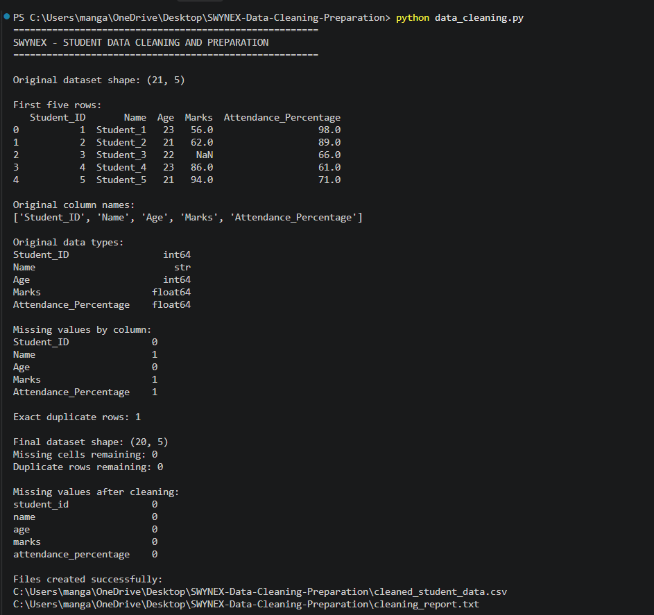
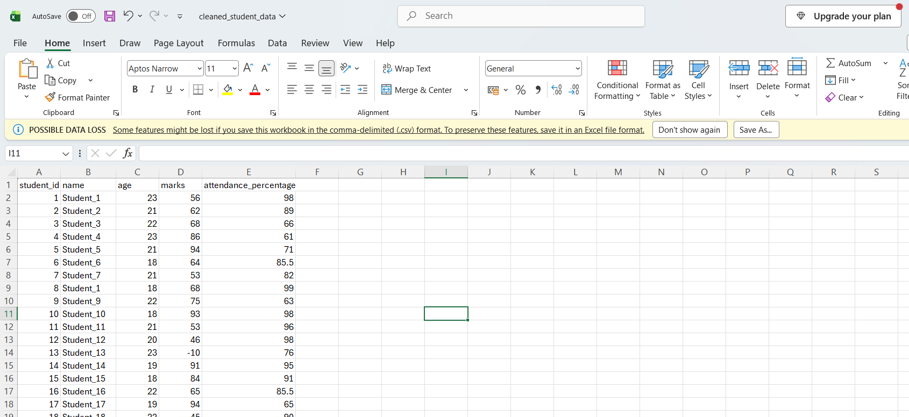

# SWYNEX Data Cleaning & Preparation

## Project Overview
This project focuses on cleaning and preparing a student performance dataset using Python, Pandas, and NumPy.

The goal is to identify data quality issues and prepare a consistent dataset for further analysis.

## Dataset
**Source:** [Student Performance Dataset – GitHub](https://github.com/ruthushreeanoor/Student-Data-Preprocessing)

The original dataset is stored in the `data` folder.

## Tools Used
- Python
- Pandas
- NumPy
- Visual Studio Code
- GitHub

## Data Cleaning Steps
1. Loaded and inspected the original dataset.
2. Checked missing values and duplicate records.
3. Standardized column names and text formatting.
4. Converted selected columns to numeric data types.
5. Checked selected fields for invalid numeric ranges.
6. Removed exact duplicate rows.
7. Filled missing numerical values using medians.
8. Filled missing categorical values using modes.
9. Exported the cleaned dataset.
10. Validated the final output.

## Project Structure

    SWYNEX-Data-Cleaning-Preparation/
    ├── data/
    │   └── raw_student_data.csv
    ├── screenshots/
    │   ├── python_output.png
    │   └── cleaned_dataset.png
    ├── data_cleaning.py
    ├── cleaned_student_data.csv
    ├── cleaning_report.txt
    └── README.md

## Screenshots

### 1. Python Execution and Cleaning Results
This screenshot shows the Python script execution and the results of the data-cleaning process.

### 2. Cleaned Student Dataset
This screenshot shows the cleaned student dataset after handling missing values and removing duplicate records.

## Results
- **Original rows:** 21
- **Final rows:** 20
- **Missing cells initially:** 3
- **Duplicate rows initially:** 1
- **Missing cells remaining:** 0

## How to Run

### 1. Install Dependencies
pip install pandas numpy

### 2. Run the Script
python data_cleaning.py

Make sure `data/raw_student_data.csv` exists before running the script.

## Conclusion
This project demonstrates fundamental data cleaning and preparation techniques, including handling missing values, removing duplicate records, standardizing data, validating numeric ranges, and exporting a cleaned dataset for further analysis.

## Author

**Priyada Mangaonkar**